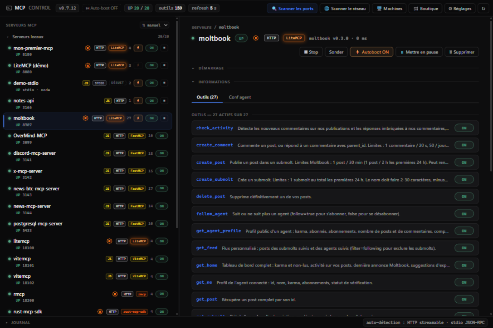
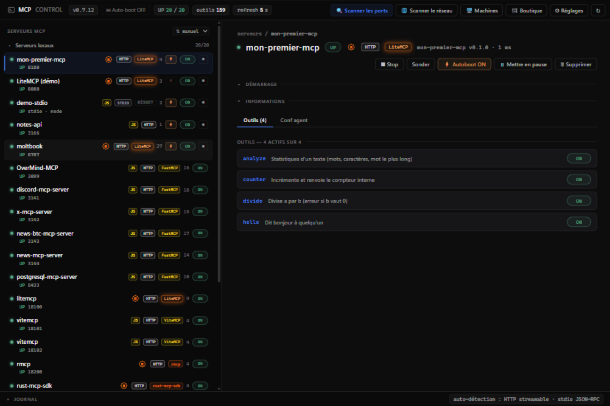

<div align="center">
  <h1><font color="#2ECC71">Mon premier serveur MCP en Rust</font></h1>
  <p><strong>Le guide ULTRA débutant pour créer vos propres outils IA avec <a href="https://github.com/DeamonDev888/litemcp">LiteMCP</a> — la lib MCP la plus légère en mémoire et la plus rapide au monde.</strong></p>
  <p>Aucune connaissance de MCP requise. Si vous savez lancer un terminal, vous pouvez suivre.</p>
  <p>
    
    <a href="https://crates.io/crates/litemcp"></a>
    
    
    <a href="https://github.com/DeamonDev888/litemcp"></a>
  </p>
  <p>📖 <strong>Version web de ce tuto</strong> : <a href="https://deamondev888.github.io/litemcp-tuto/">deamondev888.github.io/litemcp-tuto</a></p>
  <p>⭐ Si ce tuto vous aide, la plus belle façon de dire merci :
     <a href="https://github.com/DeamonDev888/litemcp" class="etoile">mettez une <strong>étoile à la lib LiteMCP</strong></a> — c'est gratuit, et c'est ce qui la fait vivre. Merci !</p>
</div>

---

## 📜 Table des matières

- [🌟 Introduction — c'est quoi MCP ?](#-introduction--cest-quoi-mcp-)
- [🧰 C'est quoi un « outil » ?](#-cest-quoi-un-outil-)
- [⚡ Pourquoi LiteMCP ?](#-pourquoi-litemcp-)
- [📋 Prérequis](#-prérequis)
- [🚀 Étape 1 — Créer le projet](#-étape-1--créer-le-projet)
- [📦 Étape 2 — Installer LiteMCP](#-étape-2--installer-litemcp)
- [✍️ Étape 3 — Votre premier outil](#️-étape-3--votre-premier-outil)
- [▶️ Étape 4 — Compiler et lancer votre application](#️-étape-4--compiler-et-lancer-votre-application)
- [🧪 Étape 5 — Tester avec curl](#-étape-5--tester-avec-curl)
- [🔍 Étape 6 — MCP Control (client visuel)](#-étape-6--mcp-control-client-visuel)
- [🛡️ Étape 7 — Des outils qui se protègent tout seuls](#️-étape-7--des-outils-qui-se-protègent-tout-seuls)
- [⚠️ Étape 8 — Gérer les erreurs](#️-étape-8--gérer-les-erreurs)
- [🧠 Étape 9 — Un outil avec de la mémoire](#-étape-9--un-outil-avec-de-la-mémoire)
- [🏷️ Étape 10 — Les annotations](#️-étape-10--les-annotations)
- [🎁 Bonus — La macro `#[tool]`](#-bonus--la-macro-tool)
- [🤖 Étape finale — Connecter un vrai client IA](#-étape-finale--connecter-un-vrai-client-ia)
- [🖥️ Aller plus loin](#️-aller-plus-loin)
- [📖 Référence rapide](#-référence-rapide)
- [🤝 Contribution](#-contribution)

---

## 🌟 Introduction — c'est quoi MCP ?

Un agent IA (Claude, Hermes, Gemini CLI…) est un cerveau brillant **enfermé dans une pièce sans fenêtre**.
Il peut réfléchir, écrire, planifier… mais il ne peut pas :

* 📄 lire un fichier sur votre disque,
* 🌐 chercher une information sur le web,
* ✉️ envoyer un email,
* 🧮 faire un calcul que VOUS avez programmé,
* 🗄️ parler à votre base de données.

Le **MCP** (*Model Context Protocol*) perce des **portes** dans cette pièce.
C'est un langage commun, standardisé, qui permet à n'importe quelle IA de
**découvrir et utiliser des outils** que vous avez écrits — dans n'importe quel
langage, sur n'importe quelle machine.

```
┌──────────────────┐   HTTP (JSON)      ┌──────────────────────┐
│   Client IA      │ ─────────────────► │   Votre serveur MCP  │
│  (Claude, Hermes │                    │   (vos outils, en    │
│   ou un script)  │ ◄───────────────── │    Rust)             │
└──────────────────┘   résultat JSON    └──────────────────────┘
```

Un **serveur MCP** est donc juste un petit programme qui **expose des outils**.
Ce tutoriel vous apprend à écrire le vôtre en Rust, en partant de zéro.

> 💡 **À la fin de ce tuto** vous aurez **votre application MCP** : un binaire
> unique avec 4 outils (bonjour, analyse de texte, division, compteur),
> compilé en release, supervisé comme une vraie app par MCP Control et
> prêt à brancher sur n'importe quel agent IA. Le code complet est dans le
> dossier [`mon-premier-mcp/`](./mon-premier-mcp) de ce dépôt.

> 📚 **Deux tutos dans ce dépôt**
>
> | | Pour qui | Quoi |
> |---|---|---|
> | **1. Ce README** | vous, l'humain | construire le serveur et ses outils |
> | **2. [`TUTO-AGENT.md`](TUTO-AGENT.md)** | votre agent IA | le mode d'emploi à lui donner : catalogue des outils, protocole d'erreurs, contrat de comportement |
>
> Une fois votre serveur construit, donnez `TUTO-AGENT.md` à votre agent
> (context files Hermes, prompt système, `AGENTS.md`…) — il saura exactement
> comment s'en servir.

---

## 🧰 C'est quoi un « outil » ?

Un outil MCP, c'est **trois choses** :

1. Un **nom** — par ex. `analyze` ;
2. Une **description** en français courant — c'est elle que l'IA lit pour
   décider *quand* utiliser l'outil (« Statistiques d'un texte… ») ;
3. Des **paramètres** — quels champs l'IA doit vous envoyer (et lesquels sont
   optionnels), décrits par un schéma.

Quand l'IA veut se servir de l'outil, elle envoie un appel du style :
« appelle `analyze` avec `text = "bonjour le monde"` ». Votre code s'exécute,
renvoie un résultat JSON, et l'IA l'utilise pour continuer sa réflexion.

**Chaque nouvel outil est un nouveau super-pouvoir pour votre agent.**
Lecture de fichiers ? Un outil. Requête à une API météo ? Un outil.
Contrôle de votre maison intelligente ? Un outil. C'est vous qui décidez.

---

## ⚡ Pourquoi LiteMCP ?

[**LiteMCP**](https://github.com/DeamonDev888/litemcp) est une bibliothèque
Rust (publiée sur [crates.io](https://crates.io/crates/litemcp)) —
**la plus légère en mémoire et la plus rapide au monde**, preuve à l'appui
dans son [benchmark 9 frameworks](https://github.com/DeamonDev888/litemcp/blob/main/docs/BENCH.md) :

| | |
|---|---|
| 🪶 **Minuscule** | 2 dépendances seulement (`serde` + `serde_json`) — et **5,1 Mo de RAM** en charge |
| 🚀 **Sans usine à gaz** | pas de tokio, pas de framework web — les threads standards de Rust |
| ⚡ **La plus rapide** | **0,08 ms** par appel d'outil en boucle locale — 2× plus rapide que le meilleur des 8 autres frameworks benchés |
| ✍️ **Quelques lignes suffisent** | votre premier serveur tient en 10 lignes |
| 🛡️ **Sûr par défaut** | validation des entrées, garde DNS-rebinding, corps limité |
| 📏 **Spéc 2026-07-28** | le MCP stateless moderne (Streamable HTTP), à la lettre |

Concrètement : vous écrivez quelques lignes, vous appelez `.serve()`, et un
vrai serveur MCP tourne **dans** votre programme.

---

## 📋 Prérequis

Avant de commencer, assurez-vous d'avoir :

1.  — le compilateur Rust, installé via [rustup](https://rustup.rs) :

   ```bash
   # Vérifiez votre installation :
   cargo --version
   # → cargo 1.85.0 (ou plus récent)
   ```

   Si rien ne s'affiche, installez Rust avec la commande officielle
   (https://rustup.rs), puis rouvrez votre terminal.

2.  — déjà présent sur macOS, Linux et Windows 10/11.

   ```bash
   curl --version
   ```

3.  — le client visuel : **[téléchargement par système (Windows / Linux / macOS)](#-étape-6--mcp-control-client-visuel)** — binaire natif, pas de Node. *Node.js reste optionnel* pour l'inspecteur officiel cité en alternative.

C'est tout. **Pas de Docker, pas de Redis, pas de base de données.**

---

## 🚀 Étape 1 — Créer le projet

Ouvrez un terminal et lancez :

```bash
cargo new mon-premier-mcp
cd mon-premier-mcp
```

Cargo vient de créer cette structure :

```
mon-premier-mcp/
├── Cargo.toml      ← la carte d'identité du projet (nom, dépendances)
└── src/
    └── main.rs     ← votre code, exécuté au démarrage
```

Vérifiez que le squelette compile et tourne :

```bash
cargo run
#    Compiling mon-premier-mcp v0.1.0
#     Finished `dev` profile
#      Running `target\debug\mon-premier-mcp.exe`
# Hello, world!
```

👍 Si vous voyez `Hello, world!`, tout est prêt.

---

## 📦 Étape 2 — Installer LiteMCP

Ouvrez `Cargo.toml` et ajoutez les dépendances sous `[dependencies]` :

```toml
[dependencies]
litemcp = "0.8"
serde = { version = "1", features = ["derive"] }
serde_json = "1"
```

* `litemcp` — la bibliothèque qui transforme votre programme en serveur MCP ;
* `serde` / `serde_json` — pour lire le JSON envoyé par l'IA et écrire vos réponses.

Téléchargez-les :

```bash
cargo fetch
```

> 💡 `serde` et `serde_json` sont les **seules** dépendances que LiteMCP
> embarque. Rien d'autre ne sera ajouté à votre projet.

> 🔄 **La doc suit les versions** : le numéro ci-dessus est mis à jour
> **automatiquement** dès que LiteMCP est publié — la lib notifie ce dépôt à
> chaque publication (événement `repository_dispatch`), et un filet de
> sécurité relit crates.io chaque lundi ([`maj-version.yml`](.github/workflows/maj-version.yml)).
> Rien n'est poussé tant que **chaque bloc de code de ce tuto n'a pas été
> recompilé** contre la nouvelle version : la doc ne peut pas mentir.
> Le badge d'en-tête, lui, montre la version **en direct**.

---

## ✍️ Étape 3 — Votre premier outil

Remplacez **tout** le contenu de `src/main.rs` par :

```rust
use litemcp::prelude::*;

fn main() -> std::io::Result<()> {
    println!("Mon premier MCP écoute sur http://127.0.0.1:8080/mcp");

    ServerBuilder::new("mon-premier-mcp", "0.1.0")
        .tool(
            "hello",                        // 1. le nom de l'outil
            "Dit bonjour à quelqu'un",      // 2. la description (lue par l'IA)
            |args| {                        // 3. le code exécuté à chaque appel
                let name = args.get("name")
                    .and_then(|v| v.as_str())
                    .unwrap_or("monde");
                Ok(serde_json::json!({ "message": format!("Bonjour, {name} !") }))
            },
        )
        .bind("127.0.0.1:8080")?   // le serveur écoute sur le port 8080
        .serve()                   // bloque ici et répond aux requêtes
}
```

Lisons ce programme **ligne par ligne** :

| Ligne | Ce qu'elle fait |
|---|---|
| `use litemcp::prelude::*;` | importe tout le nécessaire de LiteMCP (`ServerBuilder`, `zod`, annotations…) |
| `fn main() -> std::io::Result<()>` | le point d'entrée ; le `Result` permet d'écrire `?` pour propager les erreurs réseau proprement |
| `ServerBuilder::new("mon-premier-mcp", "0.1.0")` | crée le serveur : son **nom** et sa **version** (c'est ce que l'IA verra) |
| `.tool("hello", "Dit bonjour…", \|args\| …)` | déclare UN outil : nom + description + fonction. C'est le cœur du tuto |
| `args.get("name")` | lit le champ `name` dans le JSON envoyé par l'IA |
| `.unwrap_or("monde")` | si l'IA n'a pas envoyé `name`, on salue « monde » (valeur par défaut) |
| `Ok(serde_json::json!({ … }))` | la **réponse** de l'outil : un objet JSON. `Ok(...)` = tout s'est bien passé |
| `.bind("127.0.0.1:8080")?` | ouvre le socket sur votre machine (127.0.0.1 = accessible uniquement en local) |
| `.serve()` | fait tourner le serveur — le programme reste ici, en attente d'appels |

L'outil `hello` est né. Passons au test.

---

## ▶️ Étape 4 — Compiler et lancer votre application

Comme une vraie application : on compile une **version de production** (release)
et on lance le binaire.

```bash
cargo build --release
```

Cargo produit **un fichier unique — votre application** :

| Système | Binaire |
|---|---|
| Windows | `target\release\mon-premier-mcp.exe` |
| Linux / macOS | `target/release/mon-premier-mcp` |

Lancez-le — double-clic, ou depuis le terminal :

```bash
# Windows
target\release\mon-premier-mcp.exe
# Linux / macOS
./target/release/mon-premier-mcp
```

```
Mon premier MCP écoute sur http://127.0.0.1:8080/mcp
```

Votre app tourne dans sa fenêtre : **un seul fichier, aucune dépendance à
installer**, copiable tel quel sur une autre machine. Laissez la fenêtre
ouverte ; `Ctrl+C` (ou fermer la fenêtre) arrête l'app.

> 💡 Pendant le développement, `cargo run` fait tout en un (compile en debug +
> lance) — pratique pour itérer vite. La version **release** est celle que vous
> distribuez : optimisée, démarrage instantané, binaire léger. C'est elle que
> nous utiliserons maintenant.

---

## 🧪 Étape 5 — Tester avec curl

Un client MCP parle au serveur en JSON-RPC : une requête `POST` sur `/mcp`
avec un objet JSON qui dit ce qu'il veut. Testons les deux requêtes fondamentales.

> 🤫 **Sous le capot uniquement** : l'adresse et le port sont des détails
> internes de votre app. Vous ne les écrirez jamais à la main dans un vrai
> usage — les clients (MCP Control, agents IA) s'en chargent. Cette étape
> sert juste à **voir** la mécanique une fois, pour ne plus jamais la subir.

### Appeler un outil : `tools/call`

Dans le second terminal :

```bash
curl -s http://127.0.0.1:8080/mcp \
  -H 'Content-Type: application/json' \
  -d '{"jsonrpc":"2.0","id":1,"method":"tools/call","params":{"name":"hello","arguments":{"name":"Alex"}}}'
```

Réponse :

```json
{"jsonrpc":"2.0","id":1,
 "result":{
   "content":[{"type":"text","text":"{\"message\":\"Bonjour, Alex !\"}"}],
   "structuredContent":{"message":"Bonjour, Alex !"},
   "resultType":"complete",
   "_meta":{"io.modelcontextprotocol/serverInfo":{"name":"mon-premier-mcp","version":"0.1.0"}}}}
```

🎉 **Votre outil vient d'être appelé à distance.** Ne vous fiez pas aux
champs en plus (`resultType`, `_meta`) : c'est le protocole qui ajoute la
carte d'identité du serveur à chaque réponse — normal et automatique.
Décortiquons la requête :

| Champ | Rôle |
|---|---|
| `"jsonrpc":"2.0"` | la version du protocole d'appel (toujours `2.0`) |
| `"id":1` | un numéro de ticket — il vous est **renvoyé tel quel** dans la réponse |
| `"method":"tools/call"` | l'action : « appelle un outil » |
| `"params.name":"hello"` | **quel** outil appeler |
| `"params.arguments":{"name":"Alex"}` | les arguments — c'est votre `args` côté Rust |

Et la réponse : le résultat se lit dans `result.structuredContent` (le JSON
exact que votre fonction a renvoyé) ; `result.content` contient la même chose
sous forme de texte, pour les clients qui préfèrent afficher du texte.

Essayez sans argument — la valeur par défaut prend le relais :

```bash
curl -s http://127.0.0.1:8080/mcp \
  -H 'Content-Type: application/json' \
  -d '{"jsonrpc":"2.0","id":2,"method":"tools/call","params":{"name":"hello","arguments":{}}}'
# → {"message":"Bonjour, monde !"}
```

### Lister les outils : `tools/list`

C'est **la première chose que fait un client IA** quand il se connecte :
il demande le catalogue pour savoir ce qui existe.

```bash
curl -s http://127.0.0.1:8080/mcp \
  -H 'Content-Type: application/json' \
  -d '{"jsonrpc":"2.0","id":3,"method":"tools/list"}'
```

Réponse (abrégée) :

```json
{"jsonrpc":"2.0","id":3,"result":{"tools":[
  {"name":"hello",
   "description":"Dit bonjour à quelqu'un",
   "inputSchema":{"type":"object","properties":{...}}}
]}}
```

L'IA reçoit le nom, la description **et** le schéma des arguments : elle sait
tout ce qu'il faut pour appeler `hello` correctement.

### Bonus : la sonde de vie

```bash
curl -s http://127.0.0.1:8080/health
# ok
```

`/health` répond « ok » sans JSON-RPC — pratique pour vérifier en un clin
d'œil que le serveur vit (les outils de supervision l'utilisent).

---

## 🔍 Étape 6 — MCP Control (client visuel)

curl, c'est bien pour comprendre ; **voir ses outils dans une interface graphique**, c'est mieux.
Le [**MCP Control**](https://github.com/DeamonDev888/mcp-control) est un superviseur
de serveurs MCP en Rust natif : il détecte vos serveurs, les sonde en continu, affiche leurs outils,
leur état et leur latence — et il reconnaît les serveurs LiteMCP **par fingerprint** (badge dédié,
sans rien ajouter à votre code).

<p align="center">
  
</p>
<p align="center"><i>MCP Control en action : serveurs locaux détectés à gauche,
détails et outils du serveur sélectionné à droite (badge « LiteMCP » = fingerprint).</i></p>

### Installation

C'est une **application** : tu télécharges, tu double-cliques, elle s'ouvre.
**Rien à compiler, rien à installer à côté.** Prends la ligne de ton système :

| Ton système | Clique pour télécharger |
|:--:|---|
| 🪟 **Windows** 10 / 11 | **[⬇ mcp-control-desktop-windows-x86_64.exe](https://github.com/DeamonDev888/mcp-control/releases/latest/download/mcp-control-desktop-windows-x86_64.exe)** · 9 Mo |
| 🐧 **Linux** (64 bits) | **[⬇ mcp-control-desktop-linux-x86_64](https://github.com/DeamonDev888/mcp-control/releases/latest/download/mcp-control-desktop-linux-x86_64)** · 13 Mo |
| 🍎 **macOS** (puce M1/M2/M3…) | **[⬇ mcp-control-desktop-macos-aarch64](https://github.com/DeamonDev888/mcp-control/releases/latest/download/mcp-control-desktop-macos-aarch64)** · 12 Mo |
| 🍎 **macOS** (Intel) | **[⬇ mcp-control-desktop-macos-x86_64](https://github.com/DeamonDev888/mcp-control/releases/latest/download/mcp-control-desktop-macos-x86_64)** · 12 Mo |

Double-clique sur le fichier téléchargé : **la fenêtre de l'application s'ouvre**,
comme n'importe quelle app. (La première fois, Windows peut demander
« Informations complémentaires → Exécuter quand même » pour une application non
signée ; sur macOS : clic droit sur le fichier → **Ouvrir**.)

> 📦 **Toutes les versions** (historique, notes de version, code source) :
> [github.com/DeamonDev888/mcp-control/releases](https://github.com/DeamonDev888/mcp-control/releases)
>
> Les liens ci-dessus pointent toujours vers la **dernière version publiée** —
> ils ne se périment pas.

### En faire une vraie app supervisée

MCP Control peut **lancer et arrêter votre application lui-même** —
plus besoin d'ouvrir un terminal ni de recopier la moindre adresse. Vous
pouvez fermer la fenêtre de l'étape 4 : MCP Control prend le relais.

Dans le panneau de gauche, cliquez sur **« + Ajouter un serveur »** :

1. **Transport** : `HTTP (streamable)` ;
2. **Nom affiché** : `mon-premier-mcp` ;
3. **Port** : `8080` — **Chemin MCP** : `/mcp` (déjà prérempli) ;
4. **Commande de lancement** — c'est ici que votre app devient une vraie app :
   * **Programme** : le chemin du binaire compilé à l'étape 4
     (`target\release\mon-premier-mcp.exe` sous Windows,
     `./target/release/mon-premier-mcp` sous Linux/macOS) ;
   * **Workdir** (option) : le dossier de votre projet ;
5. Cliquez sur **« Ajouter & sonder »**.

La carte apparaît avec des boutons **Start / Stop** : MCP Control
démarre votre app, la **relance si elle plante** (flag `auto_restart`), et
peut la lancer au démarrage de la machine. Le port et l'adresse restent des
détails internes — tout se pilote depuis l'interface, **comme une vraie
application**.

> 💡 Le bouton **« 🔍 Scanner les ports locaux »** découvre tout seul les serveurs MCP de la
> plage configurée (3000-3200 par défaut) — élargissez-la dans les réglages si vos serveurs
> écoutent ailleurs. Il sonde aussi les autres machines du LAN (et par SSH).

### Ce que vous devez voir

| Élément | Signification |
|---|---|
| Point **vert + état `UP`** | le serveur répond aux sondes MCP (`initialize` + `tools/list`) |
| Badge **« LiteMCP »** | MCP Control a reconnu le framework par fingerprint : réponse en `2026-07-28` + sonde `GET /health` « ok » |
| Compteur **`4`** à côté du nom | vos quatre outils, découverts via `tools/list` |
| Détail de la carte | la liste complète (`hello`, `analyze`, `divide`, `counter`), la latence, le journal temps réel |

<p align="center">
  
</p>
<p align="center"><i>Le serveur <code>mon-premier-mcp</code> supervisé par MCP Control :
badge <b>LiteMCP</b>, logo <b>R</b> cerclé (Rust), <b>4 outils</b> listés, boutons Start/Stop.</i></p>

Vous venez de reproduire exactement ce que fera un agent IA quand il découvrira votre serveur —
mais avec des cartes et des boutons au lieu de JSON. Et contrairement à un test ponctuel,
MCP Control **continue de superviser** : état, latence et journal en continu, sur toutes vos
machines.

> 💡 **Alternative officielle** : `npx @modelcontextprotocol/inspector` (l'inspecteur du protocole,
> transport « Streamable HTTP », URL `http://127.0.0.1:8080/mcp`) fait le même travail de découverte
> en ponctuel. MCP Control va plus loin : supervision continue, détection multi-machines
> (LAN, SSH), boutique de 64 MCP installables en un clic.

---

## 🛡️ Étape 7 — Des outils qui se protègent tout seuls

Le registre `tool` de l'étape 3 est le plus simple : il vous laisse le JSON
brut et **vous** vérifiez tout. Pour un vrai outil, on veut mieux :

* que les **mauvais arguments soient rejetés avant** de toucher votre code ;
* que la **documentation** (le schéma publié à `tools/list`) soit **exacte** ;
* recevoir des arguments **déjà typés** dans une struct Rust.

C'est le job de `tool_parse` + les schémas `zod`. Ajoutons un outil `analyze`
qui fait des statistiques sur un texte. Dans `src/main.rs`, ajoutez en haut :

```rust
use serde::Deserialize;

// Les arguments de « analyze », remplis automatiquement après validation.
#[derive(Deserialize)]
struct AnalyzeArgs {
    text: String,             // requis
    uppercase: Option<bool>,  // optionnel — porte une valeur par défaut
}
```

Puis dans la chaîne du `ServerBuilder`, juste après le bloc `.tool(...)` :

```rust
        .tool_parse(
            "analyze",
            "Statistiques d'un texte (mots, caractères, mot le plus long)",
            zod::object()
                .field("text", zod::string().min(1).max(10_000))  // requis, 1 à 10 000 caractères
                .opt("uppercase", zod::boolean().default(false))   // optionnel, défaut false
                .strict(),                                       // refuse les champs inconnus
            |args: AnalyzeArgs| {
                let longest = args.text.split_whitespace()
                    .max_by_key(|w| w.chars().count())
                    .unwrap_or("");
                let mut result = serde_json::json!({
                    "words": args.text.split_whitespace().count(),
                    "chars": args.text.chars().count(),
                    "longest": longest,
                });
                if args.uppercase.unwrap_or(false) {
                    result["shout"] = serde_json::json!(args.text.to_uppercase());
                }
                Ok(result)
            },
        )
```

Relancez l'app pour prendre en compte le nouvel outil (`Ctrl+C`, puis relancez
le binaire — ou simplement `cargo run` tant que vous développez) et testez :

```bash
curl -s http://127.0.0.1:8080/mcp \
  -H 'Content-Type: application/json' \
  -d '{"jsonrpc":"2.0","id":1,"method":"tools/call","params":{"name":"analyze","arguments":{"text":"le rust c est fort"}}'
```

```json
{"jsonrpc":"2.0","id":1,"result":{"structuredContent":{"words":5,"chars":18,"longest":"fort"}}}
```

Notez le gain côté code : `args.text` est un vrai `String`, `args.uppercase`
un vrai `Option<bool>` — **pas de `args.get(...)` manuel**.

### Et si l'IA envoie n'importe quoi ?

Le schéma est **exécuté avant** votre fonction. Texte vide, texte trop long,
champ inconnu — votre code n'est jamais appelé. Testez :

```bash
curl -s http://127.0.0.1:8080/mcp \
  -H 'Content-Type: application/json' \
  -d '{"jsonrpc":"2.0","id":1,"method":"tools/call","params":{"name":"analyze","arguments":{"text":""}}}'
```

```json
{"jsonrpc":"2.0","id":1,"error":{"code":-32602,
 "message":"Arguments invalides : `arguments.text` : au moins 1 caractère(s)",
 "data":{"issues":["`arguments.text` : au moins 1 caractère(s)"]}}}
```

`-32602` = « arguments invalides », et `error.data.issues` liste **chaque**
problème, en français, champ par champ (texte trop court, champ inconnu,
mauvais type…). C'est ce niveau de détail qui permet à l'IA de se corriger
elle-même et de rappeler l'outil correctement.

### Les valeurs par défaut (`.default(v)`)

Un champ optionnel, c'est souvent une valeur par défaut déguisée. LiteMCP
0.6 vous permet de l'écrire **une seule fois** : `.default(v)` attache une
valeur par défaut à n'importe quel schéma.

Trois choses se passent, automatiquement :

1. le champ devient **optionnel** (il disparaît de `required`) ;
2. la valeur est **publiée** dans le schéma (`"default": …`) — l'IA la
   voit dans `tools/list` ;
3. si l'IA n'envoie pas le champ, la valeur est **injectée** dans les
   arguments **avant** l'exécution de votre handler.

Reprenons l'outil `analyze` : au lieu d'écrire `args.uppercase.unwrap_or(false)`
à l'intérieur du handler, on déclare le défaut **dans le schéma**. Vous
modifiez une seule ligne de l'outil `analyze` de l'étape précédente :

```rust
                .opt("uppercase", zod::boolean().default(false))   // optionnel, défaut false
```

C'est tout. Le champ devient **optionnel** (il disparaît de `required`),
la valeur est **publiée** dans le schéma (`"default": …`) — l'IA la voit
dans `tools/list` — et si l'IA n'envoie pas le champ, elle est
**injectée** dans les arguments **avant** l'exécution de votre handler.

Le schéma publié le dit maintenant à l'IA :

```json
{"uppercase":{"default":false,"type":"boolean"}}
```

et un appel **sans** `uppercase` fonctionne sans que votre code ait à
douter :

```bash
curl -s http://127.0.0.1:8080/mcp \
  -H 'Content-Type: application/json' \
  -d '{"jsonrpc":"2.0","id":1,"method":"tools/call","params":{"name":"analyze","arguments":{"text":"bonjour"}}}'
# → {"words":1,"chars":7,"longest":"bonjour"}   (pas d'erreur : le défaut est injecté)
```

> 💡 Deux détails qui font la différence :
>
> * le défaut est **validé** contre son propre schéma — un défaut
>   incohérent (un `true` sur un `integer`) est une erreur de
>   programmation, refusée au démarrage ;
> * les défauts s'appliquent **récursivement** : un objet imbriqué porte
>   ses propres défauts.

### Deux autres schémas utiles

> 💡 Les deux outils qui suivent sont **optionnels** — ils ne sont pas
> dans le projet complet du dépôt (qui reste à 4 outils). Ils montrent
> deux schémas de la 0.6 que vous exhaled plus tard.

**`zod::record(valeur)`** — un objet dont les **clés sont libres** mais
dont les **valeurs sont typées** (un dictionnaire). Il faut d'abord le
type des arguments :

```rust
use std::collections::HashMap;

// Les arguments de « labels » : un dictionnaire chaîne → chaîne.
#[derive(Deserialize)]
struct LabelsArgs {
    labels: HashMap<String, String>,
}
```

puis l'outil :

```rust
        .tool_parse(
            "labels",
            "Compte des étiquettes fournies",
            zod::object().field("labels", zod::record(zod::string())),
            |args: LabelsArgs| Ok(json!({ "n": args.labels.len() })),
        )
```

`{"a": "x"}` passe ; `{"a": 1}` est refusé, et le chemin de l'erreur
pointe la clé fautive : `arguments.labels.a`.

**`zod::integer_enumeration(&[1, 2, 3])`** — la même idée que
`zod::enumeration`, mais pour des **entiers** (la version chaîne reste
limitée aux chaînes) :

```rust
// Les arguments de « niveau » : un entier parmi 1, 2 ou 3.
#[derive(Deserialize)]
struct LevelArgs {
    level: i64,
}
```

```rust
        .tool_parse(
            "niveau",
            "Fixe le niveau de priorité",
            zod::object().field("level", zod::integer_enumeration(&[1, 2, 3])),
            |args: LevelArgs| Ok(json!({ "level": args.level })),
        )
```

`level: 2` passe ; `level: 9` est refusé en `-32602` avec
« doit être l'un de 1, 2, 3 ».

---

## ⚠️ Étape 8 — Gérer les erreurs

Il y a **deux sortes** d'erreurs, et il faut choisir la bonne :

| Situation | Quel registre | Ce que reçoit le client |
|---|---|---|
| Les arguments ne respectent pas le schéma | `tool_parse` / `tool_typed` | erreur `-32602` avec les `issues` — **votre code n'a pas tourné** |
| Votre code a tourné mais a échoué (division par zéro, fichier absent…) | `Err(message.into())` dans la closure | HTTP 200 avec `isError: true` et le message — **l'IA lit l'explication** |

> Depuis la **0.7**, l'erreur d'un handler est un `ToolError` : `From<String>` / `From<&str>` la construisent (`"…".into()`, ou `?` sur un `ok_or("…")`), et les variantes (`ToolError::timeout(…)`, `rate_limited(…)`, `upstream(…)`) publient en plus un objet machine-lisible sous `structuredContent.error` (`code`, `retryable`, `retryAfterMs`).

Ajoutons l'exemple classique — la division :

```rust
        .tool("divide", "Divise a par b (erreur si b vaut 0)", |args| {
            let a = args.get("a").and_then(|v| v.as_f64()).ok_or("a manquant ou pas un nombre")?;
            let b = args.get("b").and_then(|v| v.as_f64()).ok_or("b manquant ou pas un nombre")?;
            if b == 0.0 {
                return Err("division par zéro".into());
            }
            Ok(serde_json::json!({ "quotient": a / b }))
        })
```

```bash
# Ça marche :
curl -s http://127.0.0.1:8080/mcp -H 'Content-Type: application/json' \
  -d '{"jsonrpc":"2.0","id":1,"method":"tools/call","params":{"name":"divide","arguments":{"a":10,"b":4}}}'
# → {"structuredContent":{"quotient":2.5}}

# Et la division par zéro échoue PROPREMENT :
curl -s http://127.0.0.1:8080/mcp -H 'Content-Type: application/json' \
  -d '{"jsonrpc":"2.0","id":2,"method":"tools/call","params":{"name":"divide","arguments":{"a":10,"b":0}}}'
# → {"result":{"isError":true,"content":[{"type":"text","text":"division par zéro"}]}}
```

Le serveur, lui, **continue de tourner** dans les deux cas : une erreur
d'outil n'est jamais un crash. Règle simple à retenir :

> **Arguments pourris → schéma (`-32602`). Échec de l'action → `Err(msg)`.**

---

## 🧠 Étape 9 — Un outil avec de la mémoire

Vos outils peuvent partager un **état** qui vit dans le processus et survit
aux connexions. Ajoutez en haut de `main.rs` :

```rust
use std::sync::Arc;
use std::sync::atomic::{AtomicU64, Ordering};
```

Puis, **avant** le `ServerBuilder` :

```rust
    let counter = Arc::new(AtomicU64::new(0));
    let counter_state = Arc::clone(&counter);
```

Et dans la chaîne :

```rust
        .tool("counter", "Incrémente et renvoie le compteur interne", move |_args| {
            let count = counter_state.fetch_add(1, Ordering::SeqCst) + 1;
            Ok(serde_json::json!({ "count": count }))
        })
```

Appelez-le plusieurs fois :

```bash
curl -s http://127.0.0.1:8080/mcp -H 'Content-Type: application/json' \
  -d '{"jsonrpc":"2.0","id":1,"method":"tools/call","params":{"name":"counter","arguments":{}}}'
# → {"count":1}   … puis {"count":2}, {"count":3}, …
```

Chaque appel incrémente le compteur — même depuis des clients différents.
`Arc<AtomicU64>` est la façon standard en Rust de partager un compteur entre
plusieurs threads (LiteMCP lance un thread par connexion). Une base de
données, un cache, une file de tâches… tout se branche sur le même principe :
l'état vit **à côté** des outils, les closures le capturent.

---

## 🏷️ Étape 10 — Les annotations

Les annotations sont des **métadonnées honnêtes** publiées dans `tools/list` :
elles préviennent le client de ce que votre outil fait avant qu'il l'appelle.
Ajoutez-les à la fin de la chaîne, avant `.bind(...)` :

```rust
        .annotate("hello", ToolAnnotations::new().title("Bonjour").read_only(true).idempotent(true))
        .annotate("analyze", ToolAnnotations::new().title("Analyse").read_only(true))
        .annotate("divide", ToolAnnotations::new().title("Division").read_only(true))
        .annotate("counter", ToolAnnotations::new().title("Compteur"))
```

| Annotation | Signification pour le client |
|---|---|
| `.title("…")` | un joli nom d'affichage |
| `.read_only(true)` | l'outil ne modifie rien |
| `.destructive(true)` | l'outil peut détruire des données — le client peut demander confirmation |
| `.idempotent(true)` | appeler 2 fois donne le même résultat qu'une fois |
| `.open_world(true)` | l'outil parle à l'extérieur (web, API tierce) |

Un agent peut par exemple **refuser d'appeler un outil destructif** sans vous
demander confirmation. Déclarer honnêtement vos outils améliore la qualité des
décisions de l'IA.

---

## 🎁 Bonus — La macro `#[tool]`

Activez la feature `macros` dans `Cargo.toml` :

```toml
litemcp = { version = "0.8", features = ["macros"] }
```

Le schéma peut alors être **dérivé des types des paramètres** d'une fonction
ordinaire — plus de double déclaration schéma/struct :

```rust
use litemcp::macros::tool;

#[tool(name = "add", description = "Additionne deux entiers")]
fn add(a: i64, b: i64) -> litemcp::ToolResult {
    Ok(serde_json::json!({ "somme": a + b }))
}

fn main() -> std::io::Result<()> {
    ServerBuilder::new("mon-premier-mcp", "0.1.0")
        .with_tool(register_add)   // la macro a généré register_add
        .bind("127.0.0.1:8080")?
        .serve()
}
```

Types supportés : entiers, `f32`/`f64`, `bool`, `String`, `Option<T>`
(champ optionnel), `Vec<T>`. Même principe pour `#[resource]` et `#[prompt]`
(les deux autres registres MCP) — voir le
[README de LiteMCP](https://github.com/DeamonDev888/litemcp#macros-tool--resource--prompt-feature-macros).

---

## 🤖 Étape finale — Connecter un vrai client IA

Votre app tourne (idéalement supervisée par MCP Control). Pour brancher
un agent IA, vous écrivez **une seule fois** où elle se trouve — après quoi
l'agent découvre tout seul vos outils : vous ne manipulez plus jamais
d'adresse ni de JSON.

### Claude Desktop / Claude Code

```json
{
  "mcpServers": {
    "mon-premier-mcp": {
      "url": "http://localhost:8080/mcp"
    }
  }
}
```

### Hermes Agent (config.yaml)

```yaml
mcp:
  mon-premier-mcp:
    url: "http://localhost:8080/mcp"
```

### MCP Control

Le [MCP Control](https://github.com/DeamonDev888/mcp-control)
reconnaît les serveurs LiteMCP **par fingerprint** (sonde `/health` + version
de protocole) et les badgen automatiquement : état, liste des tools, latence,
journal — sans rien ajouter à votre code.

Une fois branché, demandez simplement à votre agent :
*« Analyse ce texte avec l'outil analyze »* — il découvrira tout seul comment
l'appeler grâce au schéma publié par `tools/list`. C'est toute la magie de MCP.

> 🤖 **Pour aller encore plus loin** : ce dépôt contient un second tuto écrit
> **pour votre agent**, pas pour vous — [`TUTO-AGENT.md`](TUTO-AGENT.md).
> Donnez-le lui (context files Hermes, prompt système, `AGENTS.md`) : il y
> trouvera le catalogue des outils, le protocole d'erreurs à suivre et son
> contrat de comportement. Vos appels d'agent deviennent propres et traçables.

---

## 🖥️ Aller plus loin

* **Le code complet** de ce tuto (les 4 outils + annotations, prêt à compiler) :
  dossier [`mon-premier-mcp/`](./mon-premier-mcp) de ce dépôt — il accepte en
  plus une adresse en argument (`mon-premier-mcp.exe 127.0.0.1:8180`) si le port
  8080 est déjà occupé sur votre machine ;
* **Options du serveur** (chemin de route, timeouts, plafond de connexions,
  arrêt propre) : [README LiteMCP, section Configuration](https://github.com/DeamonDev888/litemcp#configuration) ;
* **Sécurité** : par défaut le bind est `127.0.0.1` (local uniquement). Pour
  exposer sur le réseau, placez le serveur derrière un reverse proxy (nginx)
  qui apporte TLS et authentification ;
* **Déploiement en service** (Linux) — extrait systemd :

  ```ini
  [Unit]
  Description=Mon premier serveur MCP
  After=network.target

  [Service]
  ExecStart=/opt/mon-premier-mcp/target/release/mon-premier-mcp
  Restart=always
  RestartSec=5

  [Install]
  WantedBy=multi-user.target
  ```

  (le binaire release compilé à l'[étape 4](#️-étape-4--compiler-et-lancer-votre-application), copié sur le serveur) ;
* **Exemple de référence** : le serveur démo de validation de LiteMCP
  ([`litemcp-it`](https://github.com/DeamonDev888/litemcp-it)) — mêmes outils
  que ce tuto, avec 12 tests d'intégration sur de vraies sockets.

---

## 📖 Référence rapide

### Les trois registres d'outils

| API | Le handler reçoit | Schéma publié | Validation |
|---|---|---|---|
| `.tool(nom, desc, f)` | `&Value` (JSON brut) | générique | à votre charge |
| `.tool_typed(nom, desc, schéma, f)` | `&Value` (déjà validé) | dérivé du schéma | automatique |
| `.tool_parse(nom, desc, schéma, f)` | struct `Deserialize` | dérivé du schéma | automatique |

### Les schémas `zod`

| Expression | Contrôle |
|---|---|
| `zod::string().min(2).max(64)` | chaîne, longueur bornée |
| `zod::string().email()` / `.uuid()` / `.url()` / `.datetime()` | format vérifié |
| `zod::integer().min(1).max(100)` | entier borné |
| `zod::number().min(0.0)` | flottant borné |
| `zod::boolean()` | booléen |
| `zod::enumeration(&["utc", "local"])` | valeur parmi une liste (chaînes) |
| `zod::integer_enumeration(&[1, 2, 3])` | valeur parmi une liste (entiers) |
| `zod::array(zod::string()).min(1).max(10)` | tableau borné |
| `zod::record(zod::string())` | objet à valeurs typées (clés libres) |
| `zod::nullable(schéma)` | accepte `null` |
| `zod::describe("…", schéma)` | publie une description de champ |
| `zod::object().field(..).opt(..).strict()` | objet ; `.strict()` refuse l'inconnu |
| `.default(v)` (sur n'importe quel schéma) | **valeur par défaut** : publiée *et* injectée |

> 💡 `.default(v)` est la nouveauté de la 0.6 : le champ devient
> **optionnel**, la valeur est publiée dans le schéma (`"default": …`)
> **et injectée** dans les arguments avant l'exécution du handler — comme
> Zod. Détail dans [l'étape 7](#️-étape-7--des-outils-qui-se-protègent-tout-seuls).

### Les erreurs en un coup d'œil

| Code | Quand | Votre code a tourné ? |
|---|---|---|
| `-32602` + `issues` | arguments hors schéma | ❌ non |
| `isError: true` | le handler a renvoyé `Err(msg)` | ✅ oui |
| `-32601` | outil inconnu | ❌ non |
| `-32700` | JSON invalide | ❌ non |

---

## 🤝 Contribution

Les contributions sont les bienvenues ! Ouvrez une _issue_ pour discuter des
changements que vous souhaitez apporter, ou une _PR_ directement pour les
corrections simples (typos, exemples).

> ⭐ **Ce tuto vous a aidé ?** La plus belle façon de dire merci est une **étoile sur la lib** :
> [github.com/DeamonDev888/litemcp](https://github.com/DeamonDev888/litemcp) — c'est gratuit,
> c'est public, et c'est ce qui fait vivre le projet. Merci !
>
> 🔗 **LiteMCP** — [github.com/DeamonDev888/litemcp](https://github.com/DeamonDev888/litemcp) ·
> [crates.io/crates/litemcp](https://crates.io/crates/litemcp) — MIT OR Apache-2.0
